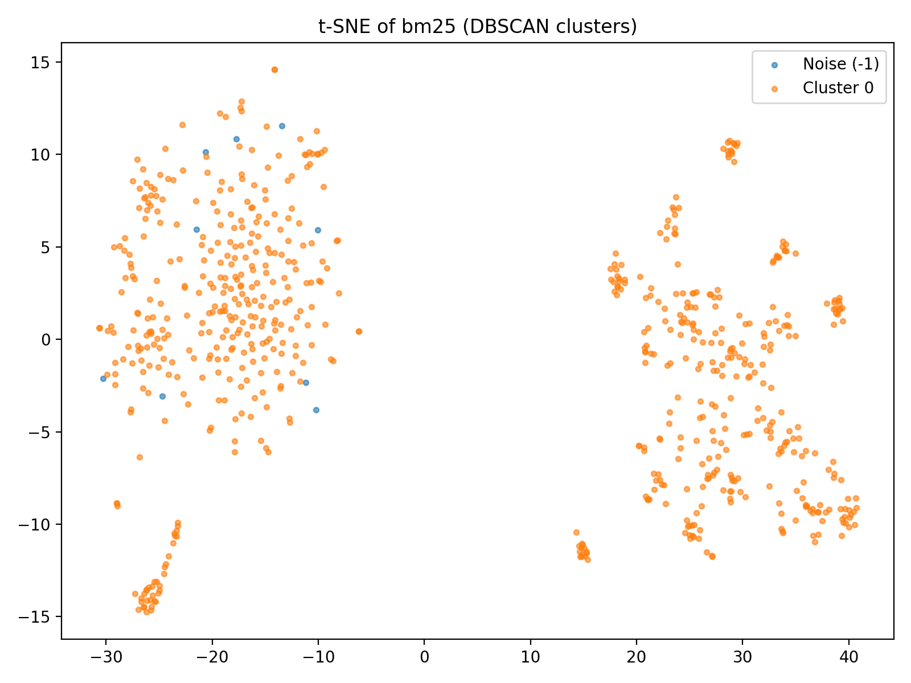
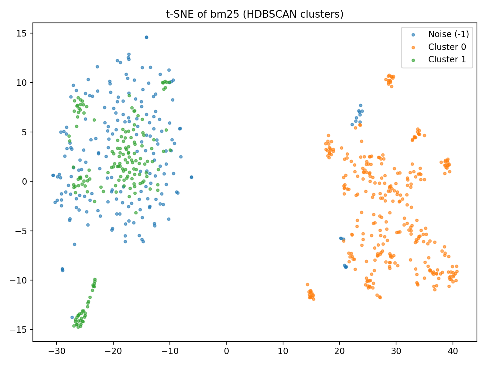
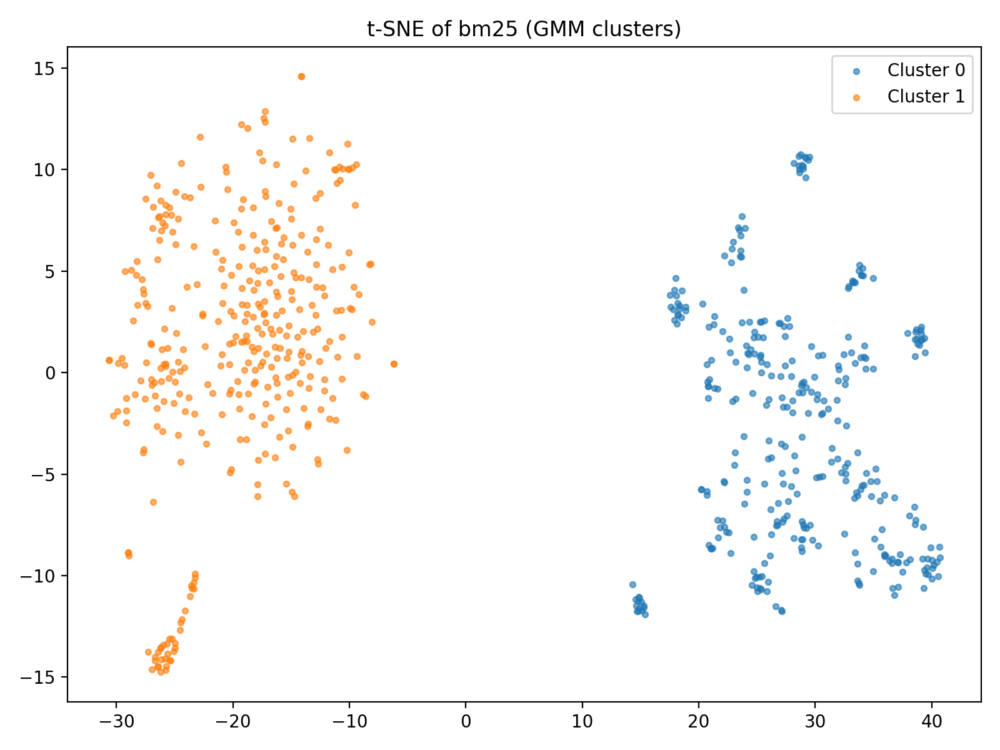
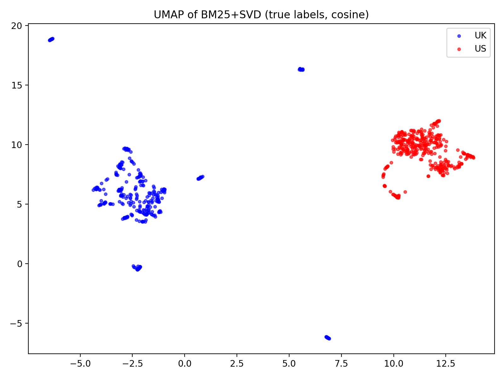
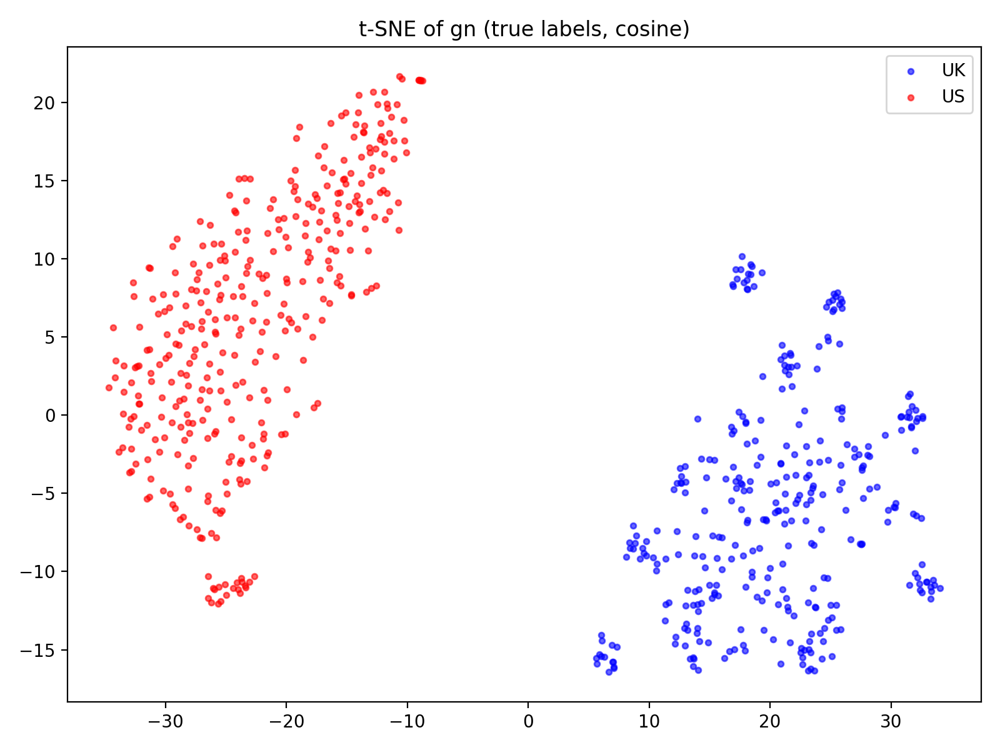
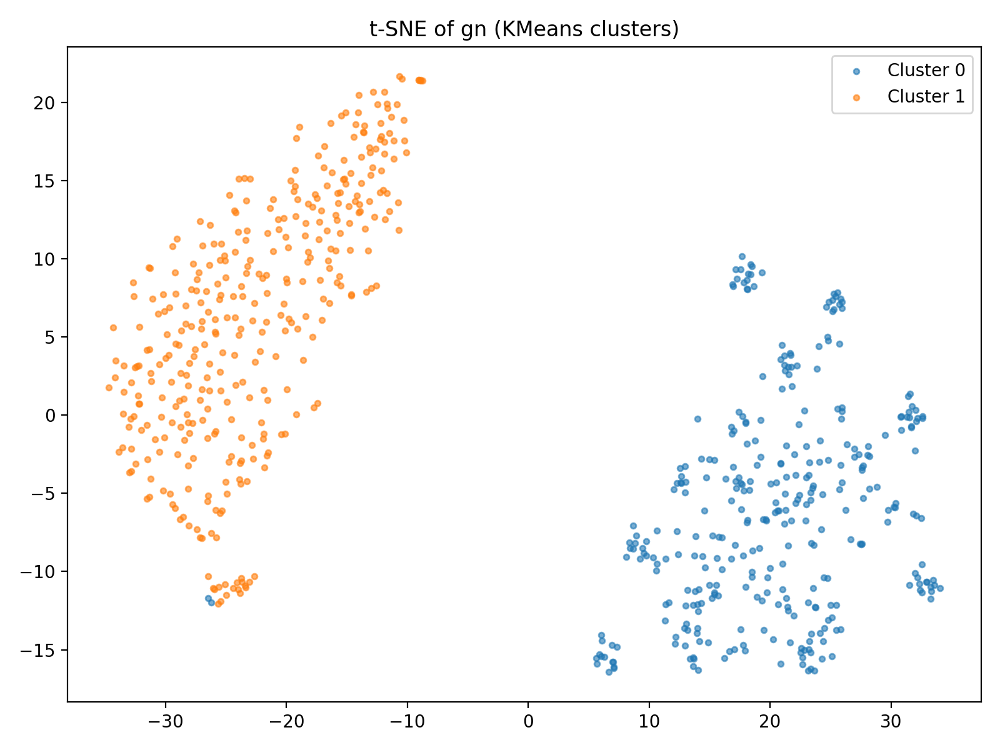
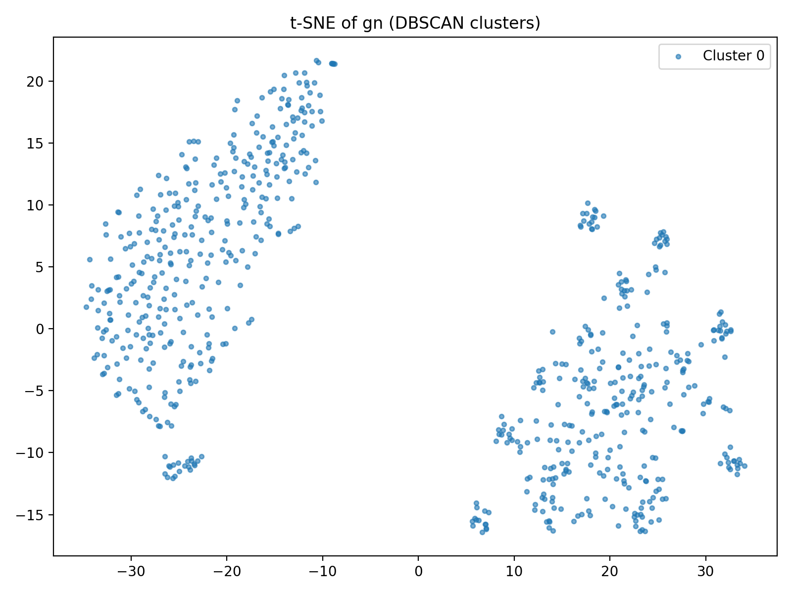
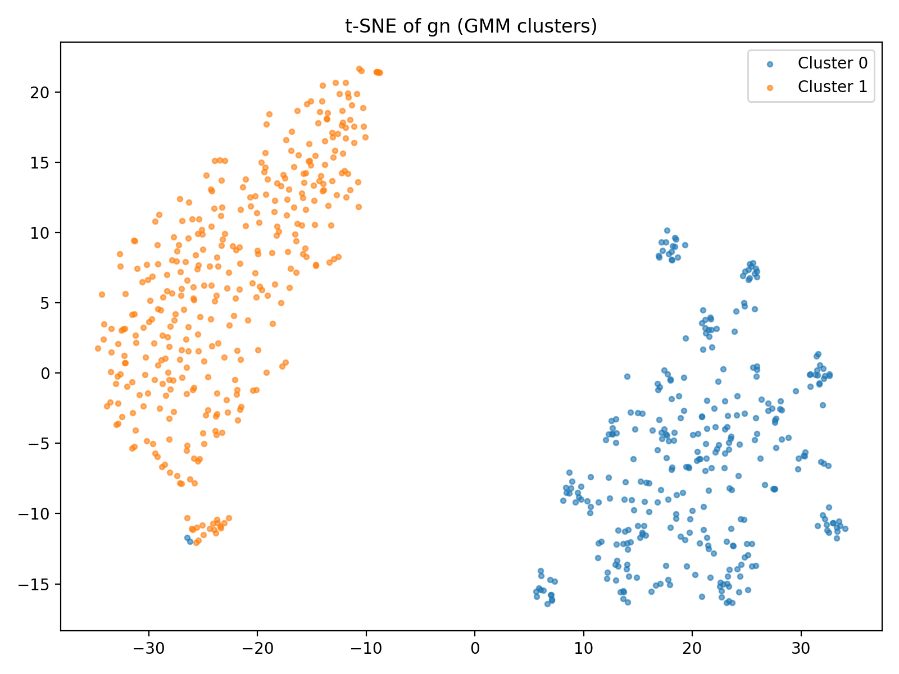
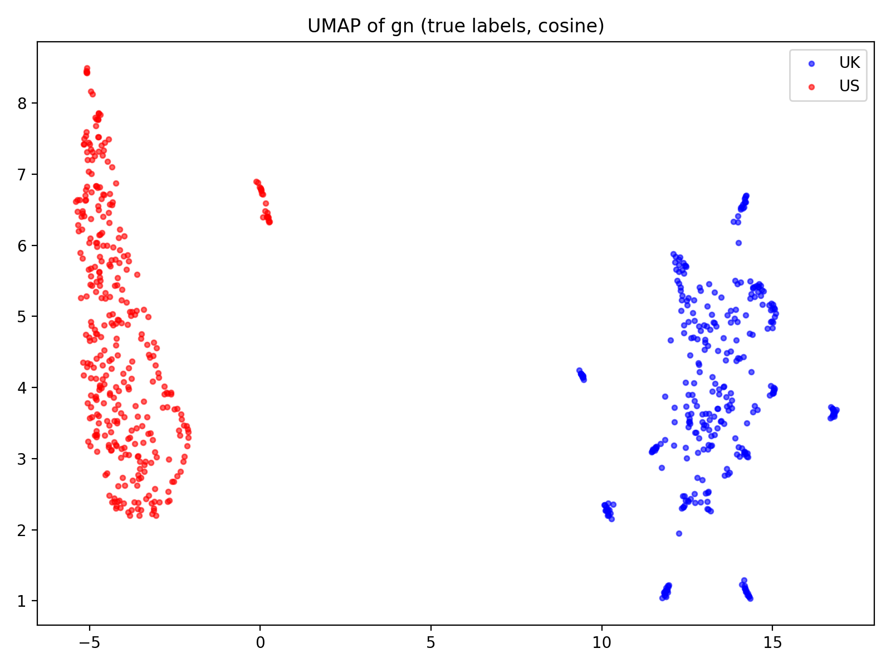

---

# 📌 Exercise 2 – UK vs US Parliamentary Debates Analysis

### 👥 Students

* **Ethan Sarfati — 345682546**
* **Ruben Bensimon — 346915424**

---

## 1. Overview

This project implements a full **text-processing, vectorization, clustering, and classification pipeline** to distinguish UK Parliamentary debates from US Congressional debates.

The dataset contains **689 transcripts**:

| Parliament         | Count |
| ------------------ | ----- |
| 🇬🇧 UK Parliament | ~329  |
| 🇺🇸 US Congress   | ~360  |

The goal is to evaluate how different NLP representation models and machine learning algorithms behave on a **strongly separable two-class political text corpus**.

The workflow includes:

* Text preprocessing (cleaning → tokenization → lemmatization)
* BM25 document-term matrix construction
* Google News (300-dim) Word2Vec embeddings
* **Dimensionality reduction (TruncatedSVD)**
* Unsupervised clustering:
  `KMeans, DBSCAN, HDBSCAN, Gaussian Mixture Models`
* Supervised classification:
  `Naive Bayes, Logistic Regression, Linear SVM, Random Forest`
* Neural models (`ANN with ReLU and GELU`)
* Feature importance extraction
* **2D visualizations: t-SNE & UMAP**

---

## 2. Project Structure

```
exo2/
├─ src/
│  ├─ 01_ex2_prepare_data.py        # preprocessing pipeline
│  ├─ 02_ex2_build_matrices.py      # BM25 + Word2Vec vectorization
│  ├─ 03_ex2_clustering.py          # unsupervised clustering experiments
│  ├─ 04_ex2_classifiers.py         # supervised ML models + feature importance
│  ├─ 05_ex2_ann.py                 # embedding-based neural networks
│  ├─ 06_ex2_visualizations.py      # t-SNE / UMAP projections
│  ├─ utils.py                      # shared helper functions
│  └─ data/
│      ├─ ex2_raw/                  # raw corpus
│      ├─ ex2_clean/                # cleaned files
│      ├─ ex2_lemm/                 # lemmatized files
│      └─ ex2_matrices/             # BM25 and embedding matrices
└─ outputs/ex2/
    ├─ ex2_feature_importance.xlsx
    ├─ tsne_bm25_true_labels.png
    ├─ tsne_bm25_kmeans_clusters.png
    ├─ umap_bm25_true_labels.png
```

---

## 3. Processing Pipeline

### 3.1 Text Preprocessing

Run:

```
python src/01_ex2_prepare_data.py
```

Steps performed:

* **Cleaning**

  * punctuation spacing
  * lowercasing
  * whitespace normalization
* **Tokenization**
* **Lemmatization**
* **Metadata assignment** (UK = 0, US = 1)

Output folders created:

```
ex2_clean/
ex2_lemm/
```

Total processed documents: **689**.

---

## 4. Vector Representations

### 4.1 BM25 Matrix

Run:

```
python src/02_ex2_build_matrices.py
```

Output:

* `BM25.npz` — sparse 689×(vocab size) matrix
* `BM25.meta.json` — vocabulary + document metadata

Used later for SVD, clustering, supervised learning, and visualization.

---

### 4.2 Google News Word2Vec Embeddings (300-d)

* Pretrained embedding loaded (≈1.6GB).
* Each document vector = average of known word embeddings.

Outputs:

* `GOOGLENEWS.npz`
* `GOOGLENEWS.meta.json`

These embeddings capture semantic similarity beyond raw term frequency.

4.3 Comparison: BM25 vs Google News Embeddings

This project evaluates two fundamentally different text representations:

BM25

Lexical, sparse document-term matrix

Based on exact word frequencies

Very discriminative for datasets where vocabulary differs strongly (UK vs US)

Google News Word2Vec (300d)

Dense, semantic representation

Captures meaning rather than exact words

Provides more natural cluster shapes in t-SNE / UMAP space

Key Insights

BM25 produces extremely sharp linear separation due to lexical differences between UK and US debates.

Google News embeddings produce more continuous and semantically meaningful clusters, while still achieving nearly 100% separability.

Both representations achieve near-perfect classification accuracy, confirming that the dataset is highly separable.

This comparison is now reflected in both clustering results and visualizations.
---

## 5. Dimensionality Reduction

Since BM25 is high-dimensional, we apply:

```
TruncatedSVD(n_components=100)
```

This preserves variance while enabling:

* efficient clustering
* cosine similarity approximations
* faster modeling

---

## 6. Unsupervised Clustering

Run:

```
python src/03_ex2_clustering.py
```

### Summary of Results

| Method                      | Concept                | Accuracy   |
| --------------------------- | ---------------------- | ---------- |
| **KMeans (k=2)**            | Linear separability    | **100%**   |
| **Gaussian Mixture Models** | Probabilistic clusters | **100%**   |
| **HDBSCAN**                 | Hierarchical density   | **97.39%** |
| **DBSCAN**                  | Density clustering     | **≈52%**   |

Interpretation:
UK and US clusters separate extremely well at lexical level.

---

## 7. Supervised Classification

Run:

```
python src/04_ex2_classifiers.py
```
separation in 2 classes:
class 0 : UK
class 1: US

Models trained using 10-fold cross-validation:

* Multinomial Naive Bayes
* Logistic Regression
* Linear SVM
* Random Forest

**All models achieved:**

```
Accuracy = Precision = Recall = F1 = 1.00
```

Feature importance exported to:

```
outputs/ex2/ex2_feature_importance.xlsx
```

---

## 8. Neural Networks (ANNs)

Run:

```
python src/05_ex2_ann.py
```

Architectures tested:

* Dense layers + **ReLU**
* Dense layers + **GELU**

Both achieved:

```
100% accuracy on held-out test dataset
```

---

## 9. Visualizations

Run:

```
python src/06_ex2_visualizations.py
```

Generated figures:

### t-SNE with true labels

## 📊 BM25 Visualizations

### t-SNE (true labels)


### t-SNE (KMeans)


### t-SNE (DBSCAN)


### t-SNE (HDBSCAN)


### t-SNE (GMM)


### UMAP (true labels)


---

## 📊 Google News Visualizations

### t-SNE (true labels)


### t-SNE (KMeans)


### t-SNE (DBSCAN)


### t-SNE (HDBSCAN)


### t-SNE (GMM)


### UMAP (true labels)


These confirm extremely clear UK/US separation.

---

## 10. Full Pipeline Reproduction

To fully reproduce:

```
python src/01_ex2_prepare_data.py
python src/02_ex2_build_matrices.py
python src/03_ex2_clustering.py
python src/04_ex2_classifiers.py
python src/05_ex2_ann.py
python src/06_ex2_visualizations.py
```

Requirements:

* `gensim-downloader` (Google News embeddings)
* `nltk wordnet` & required corpora

---

