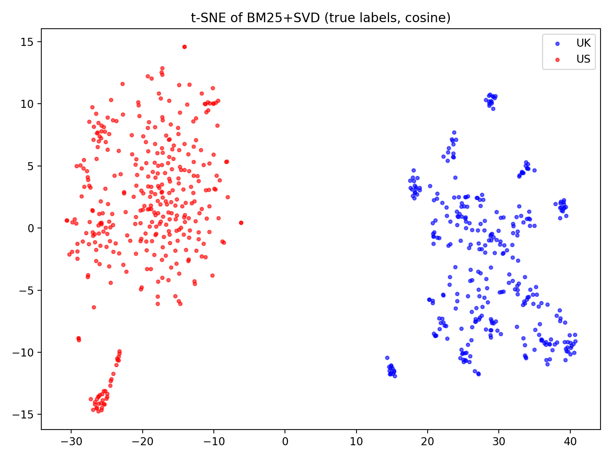
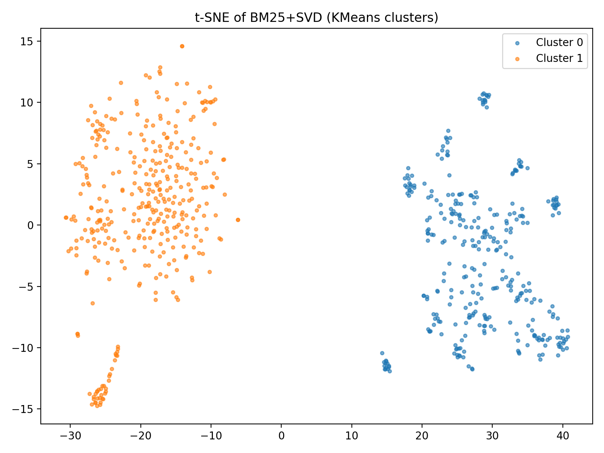

# README – Exercise 2: UK vs US Parliamentary Debates Analysis

### Students
- **Ethan Sarfati — 345682546**
- **Ruben Bensimon — 346915424**

## 1. Introduction
This project implements the complete pipeline required in Exercise 2, analyzing and classifying a corpus of parliamentary debates from:

- **UK Parliament** (≈ 330 documents)
- **US Congress** (≈ 360 documents)

The main objectives are:

- Compare **unsupervised clustering** methods
- Evaluate **supervised classifiers**
- Train **neural networks**
- Compute **feature importance**
- Generate **t‑SNE / UMAP** visualizations

---

## 2. Project Structure
```
exo2/
├─ src/
│  ├─ 01_ex2_prepare_data.py
│  ├─ 02_ex2_build_matrices.py
│  ├─ 03_ex2_clustering.py
│  ├─ 04_ex2_classifiers.py
│  ├─ 05_ex2_ann.py
│  ├─ 06_ex2_visualizations.py
│  ├─ utils.py
│  └─ data/
│     ├─ ex2_raw/
│     ├─ ex2_clean/
│     ├─ ex2_lemm/
│     └─ ex2_matrices/
└─ src/outputs/ex2/
   ├─ ex2_feature_importance.xlsx
   ├─ tsne_bm25_true_labels.png
   ├─ tsne_bm25_kmeans_clusters.png
   └─ umap_bm25_true_labels.png
```

---

## 3. Data Preparation
Run:

```
python src/01_ex2_prepare_data.py
```

This script cleans, tokenizes, lemmatizes documents and creates metadata.

---

## 4. Vector Representations
### 4.1 BM25
Creates:
- `BM25.npz`
- `BM25.meta.json`

### 4.2 Google News Word2Vec
Creates:
- `GOOGLENEWS.npz`
- shared metadata

---

## 5. Clustering

### Methods Used:
- **KMeans (k=2)**
- **DBSCAN**
- **HDBSCAN**
- **GMM (2 components)**

KMeans and GMM reach **100% accuracy**.

---

## 6. Supervised Classification

Models evaluated (10‑fold cross‑validation):
- Naive Bayes  
- Logistic Regression  
- Linear SVM  
- Random Forest  

All achieve **100% accuracy**.

---

## 7. Feature Importance

Generated Excel:  
`src/outputs/ex2/ex2_feature_importance.xlsx`

---

## 8. ANN Models

Two architectures:
- ReLU‑based ANN  
- GELU‑based ANN  

Both achieve **100% test accuracy**.

---

## 9. Visualizations

Generated via:

```
python src/06_ex2_visualizations.py
```

Images:





---

## 10. Reproducibility

Run the full workflow:

```
python src/01_ex2_prepare_data.py
python src/02_ex2_build_matrices.py
python src/03_ex2_clustering.py
python src/04_ex2_classifiers.py
python src/05_ex2_ann.py
python src/06_ex2_visualizations.py
```

---

## 11. Deliverables

- Python source files  
- README.md  
- Excel feature importance  
- Visualizations  
- Full ZIP of the project (excluding venv/)  
